# MatriLab EPIS · React Native

Aplicación multiplataforma para la matrícula en los laboratorios de la Escuela Profesional de Ingeniería de Sistemas de la UNSA. Es el **Laboratorio 04 de Plataformas Emergentes (E), semestre 2026-B**: doce interfaces construidas solo con los componentes propios de React Native, diseñadas a partir del árbol de problemas del proceso de matrícula.

- **Demo web:** <https://owerlopez.github.io/matrilab-epis-react-native/>
- **Informe:** [`informe/LAB04_Plataformas_Emergentes_MatriLab_React_Native.pdf`](informe/LAB04_Plataformas_Emergentes_MatriLab_React_Native.pdf) · [versión DOCX](informe/LAB04_Plataformas_Emergentes_MatriLab_React_Native.docx)

| Inicio de sesión | Panel del estudiante | Catálogo | Detalle del grupo | Pase QR | Horario |
|---|---|---|---|---|---|
| 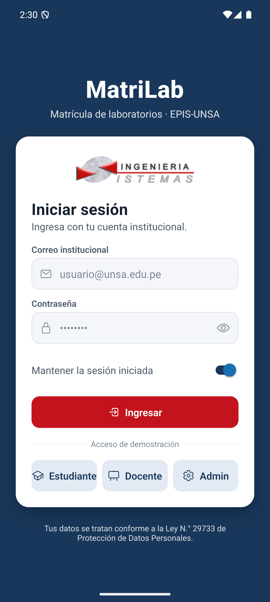 | 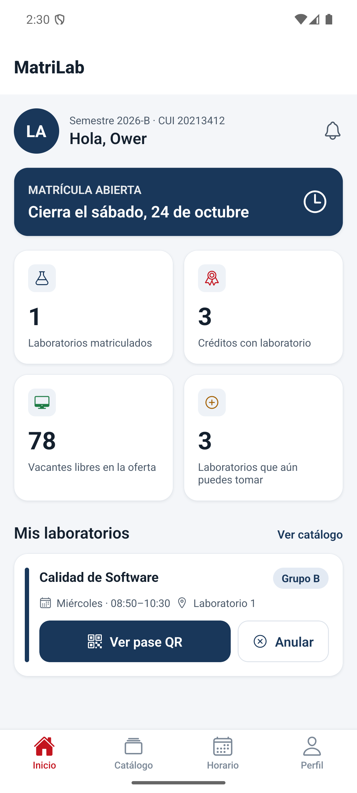 | 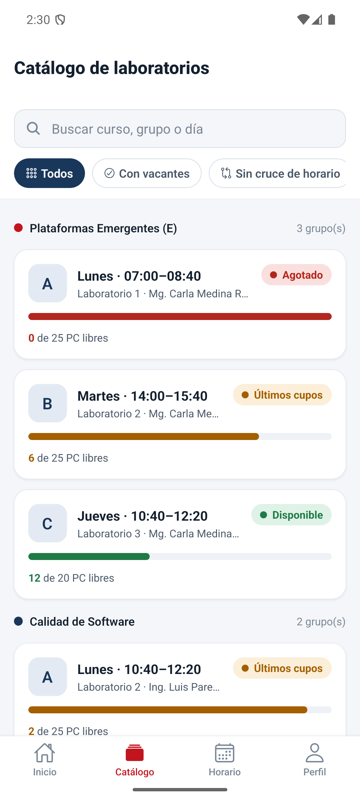 | 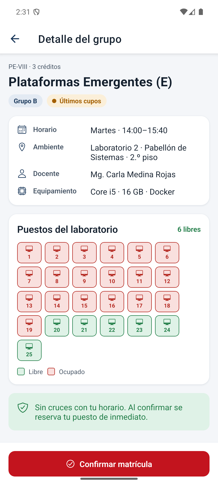 | 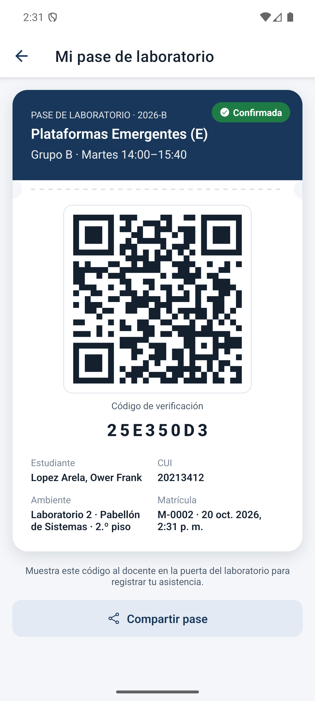 | 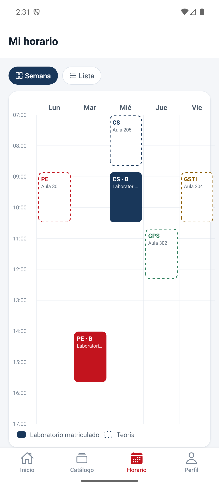 |

| Panel docente | Nómina | Escáner QR | Laboratorios | Matrícula | Perfil |
|---|---|---|---|---|---|
| 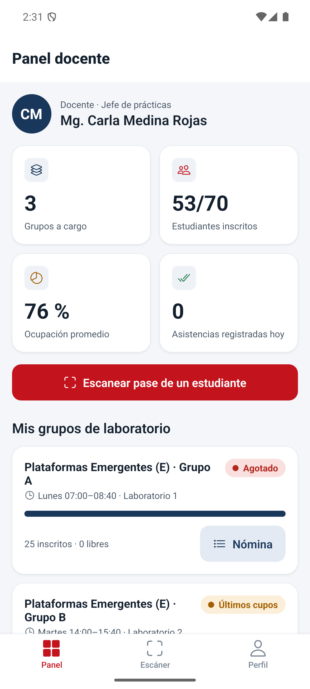 | 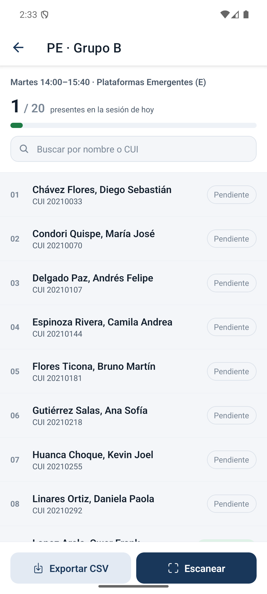 |  | 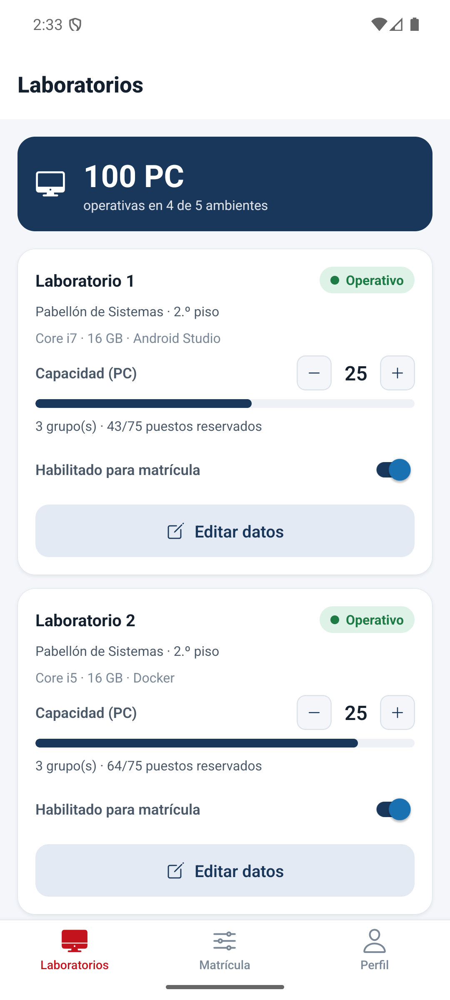 | 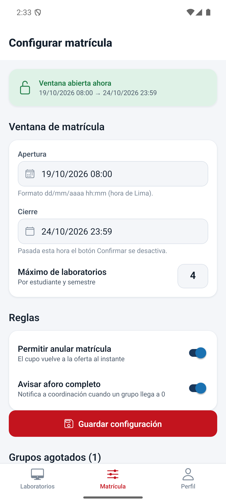 | 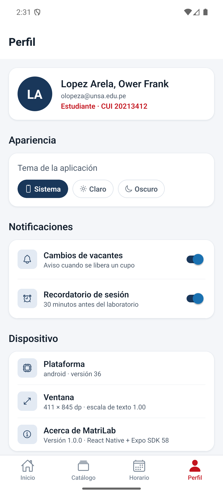 |

Capturas tomadas en un emulador Pixel 7a con Android 16 (API 36) y Expo Go.

## Funcionalidades

| Rol | Qué puede hacer |
|---|---|
| Estudiante | Ver la oferta con semáforo de vacantes, filtrar grupos sin cruce, revisar el mapa de puestos, matricularse con validación de cruces (RN-02) y reserva atómica, mostrar y compartir su pase QR, consultar su horario semanal y anular una matrícula. |
| Docente | Ver la ocupación de sus grupos, abrir la nómina, marcar asistencia, leer el QR del pase con la cámara o digitar el código de verificación y exportar la nómina en CSV. |
| Coordinación | Ajustar capacidad, estado y datos de cada laboratorio, configurar la ventana de matrícula y las reglas, y revisar los grupos agotados. |

Cuentas de demostración (contraseña `unsa2026`): `olopeza@unsa.edu.pe`, `cmedina@unsa.edu.pe` y `laboratorios.epis@unsa.edu.pe`, o los botones *Estudiante*, *Docente* y *Admin* del inicio de sesión.

## Tecnología

React Native 0.88 · Expo SDK 58 · React 19.3 · TypeScript 6 · React Navigation 7 (`native-stack`, `bottom-tabs`) · `expo-camera` · `react-native-qrcode-svg` · `react-native-safe-area-context` · `react-native-web` · Jest 30.

La interfaz no usa librerías de componentes visuales: tarjetas, botones, chips, insignias y barras de progreso están hechos con `View`, `Text` y `Pressable` en [`src/components/ui.tsx`](src/components/ui.tsx). El layout se resuelve con Flexbox, `position: 'absolute'`, `FlatList`/`SectionList`, `Modal`, `KeyboardAvoidingView` y `useWindowDimensions`.

## Ejecución

```bash
npm install
npx expo start          # abrir con Expo Go o pulsar «a» para el emulador Android
npm test                # 31 pruebas unitarias del dominio y del estado
npm run test:cobertura  # con reporte de cobertura
npm run typecheck       # tsc --noEmit en modo estricto
npm run export:web      # versión web en dist/
```

El recorrido automático de capturas en Android (`herramientas/capturas-android.mjs`) localiza cada control por su etiqueta de accesibilidad con `uiautomator`:

```bash
EXP_URL=exp://<ip-de-metro>:8081 node herramientas/capturas-android.mjs docs/capturas
```

## Estructura

```
src/
  domain/       types.ts, reglas.ts (reglas puras), datos.ts (semestre 2026-B)
  state/        AppStore.tsx: Context + useReducer y selectores
  theme/        tokens.ts (paletas clara y oscura) y ThemeContext.tsx
  components/   ui.tsx: componentes reutilizables
  navigation/   RootNavigator.tsx y tipos.ts
  screens/      LoginScreen, PerfilScreen, estudiante/, docente/, admin/
__tests__/      reglas.test.ts
herramientas/   capturas-android.mjs
informe/        informe en LaTeX y DOCX, diagramas y generadores
```

## Informe

La carpeta [`informe/`](informe) contiene el informe del laboratorio en el formato de la EPIS:

- `main.tex` y `sections/`: fuente LaTeX (compila con XeLaTeX o Tectonic).
- `LAB04_..._React_Native.pdf`: informe compilado, centrado en capturas y explicaciones de cada interfaz.
- `LAB04_..._React_Native.docx`: versión para la entrega en Word, con el código de la aplicación en los anexos.
- `fuentes/diagramas/`: árbol de problemas, árbol de objetivos, mockups, navegación, arquitectura y patrones de Flexbox en HTML, renderizados con `render.mjs`.
- `fuentes/construir.py`: genera las secciones LaTeX a partir de `contenido.py` (con `--docx` también el documento Word); `componer_figuras.py` arma las figuras de mockups y capturas.

## Equipo

- Lopez Arela, Ower Frank
- Zegarra Puma, Mauricio Eduardo
- Huamani Chañi, Diego Oswaldo

Docente: M. Sc. Ing. R. Fabrizio Calienes Rodriguez · Universidad Nacional de San Agustín de Arequipa.
